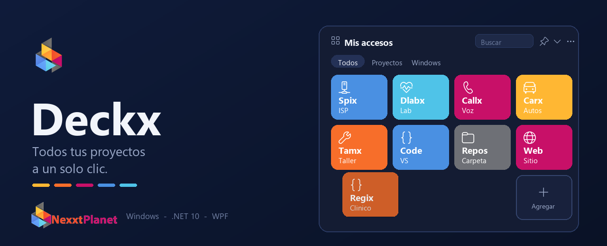

<p align="center">
  
</p>

# Deckx

Widget de escritorio para Windows, al estilo de un StreamDeck: una rejilla de mosaicos que abre
soluciones de Visual Studio, programas, carpetas o paginas, organizados por grupos.

Nacio de un problema concreto: tener doce soluciones de Visual Studio y perder tiempo buscando
cual abrir. Un mosaico, un clic.

## Que hace

- **Clic** en un mosaico: abre lo que tenga configurado. Un `.slnx` o `.sln` arranca Visual Studio,
  un `.exe` arranca el programa, una carpeta abre el explorador y una url abre el navegador.
- **Clic derecho**: abrir, abrir carpeta, abrir en VS Code, abrir terminal, editar, eliminar.
- **Arrastrar el panel**: mueve el widget a donde quieras y guarda la posicion.
- **Arrastrar un mosaico** sobre otro: lo reordena. Soltarlo sobre el mosaico punteado lo manda al final.
- **Agregar**: el mosaico punteado abre el dialogo, con buscador de archivo y de carpeta,
  20 iconos, 10 colores, grupo y vista previa en vivo.
- **Cabecera**: buscar, fijar encima, colapsar y opciones (3 a 6 columnas, transparencia).

## Instalar

Necesitas el [SDK de .NET 10](https://dotnet.microsoft.com/download) y Windows 10 u 11.

```
git clone https://github.com/hebalmert/Deckx-WPF.git
cd Deckx-WPF
dotnet build Deckx.slnx -c Release
```

El ejecutable queda en `Deckx\bin\Release\net10.0-windows\Deckx.exe`.

La primera vez carga la semilla `projects.json` de ejemplo; a partir de ahi tu configuracion vive en
`%APPDATA%\Deckx\widget.json` y no se pierde al recompilar.

## Configuracion

Todo se arma desde la interfaz, pero el archivo es texto plano por si prefieres editarlo a mano:

```json
{
  "Name": "Mi proyecto",
  "Subtitle": "Lo que hace",
  "Path": "C:\\Ruta\\A\\MiSolucion.slnx",
  "Arguments": "",
  "IconGlyph": "\uE943",
  "Color": "#378ADD",
  "Group": "Proyectos",
  "Order": 1
}
```

`Path` admite variables de entorno (`%USERPROFILE%`), rutas de archivo, carpetas y urls.
`IconGlyph` es un glifo de Segoe Fluent Icons, la fuente que ya trae Windows.

## Como esta hecho

.NET 10 y WPF, sin una sola dependencia externa: ni NuGet, ni red, ni base de datos. Todo ocurre
en tu maquina.

```
Deckx/
  Models/     ShortcutItem, WidgetConfig
  Services/   ConfigService (json), LaunchService (abrir), CatalogService (iconos y colores)
  Views/      MainWindow (el widget), EditItemWindow (agregar y editar)
```

Sin MVVM ni frameworks a proposito: es una utilidad de escritorio, y el code-behind directo con
estilos en `App.xaml` se lee y se corrige en un solo lugar.

## Licencia

MIT. Usalo, copialo y cambialo como quieras.
